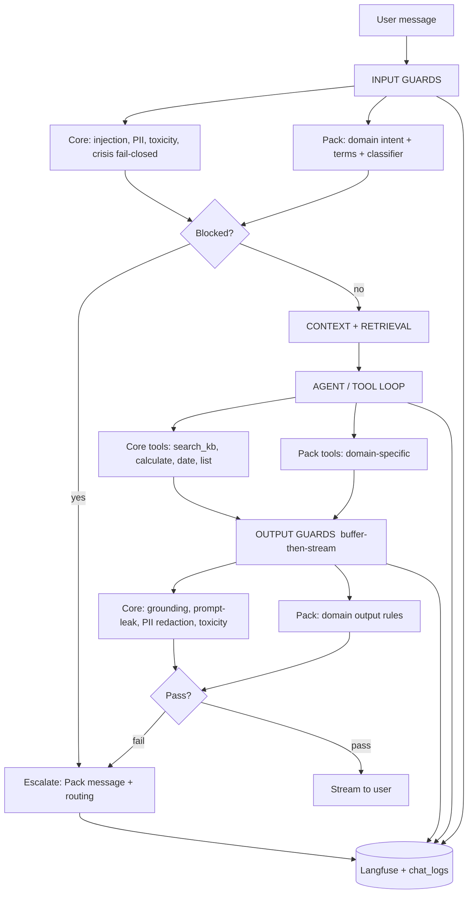

# Harness Architecture — Core + Domain Packs

> **Status:** Phase 6 complete — harness productization finished. Per-pack offline eval suites (deterministic guardrail scorecard, 100% on labeled red-team datasets) + per-deployment `DOMAIN` / `GUARD_MODEL` compose wiring; 246 tests green. Health pack behavior unchanged.
> **Goal:** Turn the current medical-only chatbot into a productized, per-deployment
> harness that ships as **one Core** plus **one Domain Pack** (health, HR, or e-commerce).
> **Constraint:** 100% local / open-source — Ollama, Python, Postgres+pgvector, Langfuse (self-hosted). No cloud.

---

## 1. Vision

```
Client deployment  =  Core Harness  +  exactly ONE Domain Pack

        HR client  =  Core  +  hr-pack
    Health client  =  Core  +  health-pack
 Ecommerce client  =  Core  +  ecommerce-pack
```

Two rules keep this clean and sellable:

1. **Core is domain-agnostic and never edited per client.** It ships identically everywhere.
2. **A Pack is rules + config that plug into defined slots in the Core.** A new domain = implement the Pack contract; no Core changes.

**Deployment model:** *per-deployment* (one domain per install), **not** multi-tenant.
One Docker image; deployments differ only by `DOMAIN=...` in `.env` and the knowledge-base content.
Each client runs their own isolated stack — nothing shared, nothing leaves their network.

---

## 2. The Full Harness Pipeline

Every stage has a **Core layer (always on)** and an optional **Pack layer (domain)**.



| Stage | Core layer (always on) | Pack layer (domain) |
|---|---|---|
| **Input guards** | prompt-injection/jailbreak, PII detect, toxicity, **self-harm/crisis (fail-closed)** | medical-intent / HR-legal / ecommerce-manipulation tiers |
| **Context / retrieval** | RAG, distance gate, chunking | KB seed content, top-k tuning |
| **Agent / tools** | `search_kb`, `calculate`, `get_current_date`, `list_products` | domain tools (`check_order_status`, `lookup_pto_policy`, …) |
| **Output guards** | grounding/faithfulness, prompt-leak block, PII redaction, toxicity | domain output rules (no binding discounts, no legal advice) |
| **Escalation** | escalation mechanics | the message + routing target |
| **Observability** | Langfuse tracing, `chat_logs` | tags = pack name + tier that fired |
| **Eval** | core guard tests | domain test suite (cf. current 40 medical tests) |

> **All phases complete.** The **input and output guard stages** both exist (buffer-then-stream).
> The **Core universal guards** (crisis, prompt-injection, PII in/out, prompt-leak, plus the
> optional **Llama Guard 3** model on both sides) run ahead of every pack, the **Pack abstraction**
> holds each domain's logic in `packs/{health,hr,ecommerce}/` behind the harness contract, the active
> pack is chosen per-deployment via `DOMAIN`, and every pack ships an **offline eval scorecard**
> (`eval_packs.py`) proving its guardrails on labeled red-team datasets.

---

## 3. The Pack Contract

The single interface every domain implements. A new domain = fill this in.

```text
Pack:
  name:                 "health" | "hr" | "ecommerce"
  version:              "1.2.0"            # packs version independently
  input_guards()     -> [Guard, ...]       # domain tier 1/2/3
  output_guards()    -> [Guard, ...]
  tools()            -> [Tool, ...]
  system_prompt      -> str
  escalation_message -> str
  escalation_routing -> "EAP" | "HR rep" | "support"
  config             -> thresholds, model names, fail-policy
  eval_dataset       -> test cases
```

### Guard interface (Core and Pack guards are interchangeable)

```text
Guard:
  name:    str
  tier:    "tier1_regex" | "tier2_terms" | "tier3_model" | "output"
  stage:   "input" | "output"
  policy:  "fail_open" | "fail_closed"
  check(ctx) -> GuardResult { blocked: bool, reason: str, redactions: [...] }
```

The existing `check_medical()` becomes one `Guard` inside the `health` pack — minimal rewrite.

---

## 4. Merge & Fail-Policy Rules

- **Core guards always run; pack guards are appended.** A client can never disable injection/crisis protection.
- **A Pack can tune but not weaken Core** — it may raise thresholds, add terms, override the escalation message/routing, but not remove a Core guard.
- **Fail policy is per-category (set in config):**
  - `crisis`, `medical-advice` → **fail-closed** (error → block).
  - `toxicity`, `off-topic`, `tier3` classifier → **fail-open** (error → allow; never break UX). *(Generalizes today's "Tier 3 fails open".)*
- **Ordering:** cheap deterministic guards first (regex/dictionary, ~0 ms), expensive model guards last (Llama Guard 3). Clean queries rarely reach the model.

---

## 5. Per-Domain Guard Matrix

### Health (existing, to be packaged)
| Tier | Examples |
|---|---|
| 1 regex intent | `can i take`, `my symptoms`, `diagnose me`, `i have a fever` |
| 2 terms | `anaphylaxis`, `sepsis`, `drug interaction`, `iron deficiency` |
| 3 model | personal medical/diagnosis/treatment/nutrition advice |
| escalation | "Speak to your Healthcare Practitioner" → HCP |

### HR
| Tier | Examples |
|---|---|
| 1 regex intent | `can i sue`, `report my manager`, `am i being discriminated` |
| 2 terms | `wrongful dismissal`, `harassment claim`, `whistleblower` |
| 3 model | individual legal/grievance action vs. general policy info |
| 3rd-party PII | "What's Jane's salary?" → block |
| escalation | route to HR rep / formal grievance channel |

### E-commerce
| Tier | Examples |
|---|---|
| 1 regex intent | `give me X% off`, `you said it's free`, `confirm my refund` |
| 2 terms | payment-data terms, `chargeback`, `guarantee delivery` |
| 3 model | binding-commitment / discount manipulation / off-policy promise |
| other-customer PII | order/account isolation |
| escalation | route to human support / fraud review |

### Universal Core (all domains, always on)
- **Crisis / self-harm** (fail-closed, own escalation → helpline).
- **Prompt-injection / jailbreak** ("ignore previous instructions", system-prompt extraction).
- **PII** detect + redact (input logging + output).
- **Toxicity / abuse** (both directions).
- **Output grounding** — answer must come from retrieved chunks (citations enforced).
- **Prompt-leak** — block the model echoing its system prompt.

---

## 6. Output Guards — Streaming Strategy (decided: **buffer-then-stream**)

Output guards need the full response *before* the user sees it. Chosen approach:

```
generate full response (no streaming to client)
        │
        ▼
run Core + Pack output guards on the buffered text
        │
   ┌────┴─────────────┐
 pass               fail
   │                  │
stream to user   escalate / replace with safe message
```

- Safest for health/HR (no unsafe token ever reaches the user).
- Trade-off: user waits for the full answer (loses live-typing feel). Acceptable for these domains.
- Optional later: hybrid mode (live stream + inline PII redaction + final grounding check) as a per-pack config flag.

---

## 7. Tier 3 = Guard Model (Llama Guard 3, local in Ollama)

- A guard model is a small LLM fine-tuned **only for safety classification** — input is a conversation (+ optional draft answer + policy taxonomy), output is `safe` / `unsafe: <category>`.
- **Llama Guard 3 (Meta)** pulled into Ollama; runs entirely local.
- Replaces the hand-written YES/NO prompt per domain — the model already knows categories (self-harm, hate, sexual, violence, PII, jailbreak…), with a custom policy layer for domain rules.
- Used on **input and output** (same model checks the draft answer).
- Cheap regex/dictionary tiers stay as a fast pre-filter; the guard model runs only when needed, async.

---

## 8. Domain Selection (per-deployment)

```
.env  →  DOMAIN=health            # or hr, ecommerce
            │
   registry.load(DOMAIN)  →  one Pack object
            │
   pipeline = Core layers + Pack layers   (resolved once at startup)
```

- Same image everywhere; deployment differs only by `DOMAIN` + KB content.
- Mirrors the existing pattern where `escalation_message` already comes from DB settings — `DOMAIN` is the same idea, one level up.
- Inactive packs sit dormant in the repo (optionally stripped at build for footprint / IP isolation).

---

## 9. Target Directory Structure (refactor in place)

```
kenvue-agentic/api/
  harness/
    contracts.py          # Pack, Guard, GuardResult, Tool protocols
    registry.py           # DOMAIN -> pack
    pipeline.py           # orchestrates stages, merges core+pack, fail-policy
    core/
      guards/
        injection.py
        pii.py
        crisis.py
        toxicity.py
      output/
        grounding.py
        prompt_leak.py
        redaction.py
      tools/              # search_kb, calculate, date, list_products
      guard_model.py      # Llama Guard 3 client
  packs/
    health/
      pack.py
      intents.py          # current Tier 1 regex
      terms.py            # current Tier 2 dictionary
      classifier.py       # Tier 3 prompt (until guard model)
      system_prompt.txt
      escalation.txt
      tools.py
      config.py
      eval/
    hr/        ...
    ecommerce/ ...
  routers/chat.py         # calls pipeline instead of inline guardrails
```

Existing files (`guardrails.py`, `agent_tools.py`, `rag.py`) keep working during the transition; logic moves into the structure above incrementally.

---

## 10. Phased Roadmap (Checklist)

- [x] **Phase 0 — Architecture design doc** → this document (shared reference)
- [x] **Phase 1 — Guard interface + registry; extract medical → `health` pack** → no behavior change; 83 tests green (40 guardrail + 43 API)
  - [x] `harness/contracts.py` — `Guard`, `GuardResult`, `GuardContext`, `Pack`
  - [x] `harness/registry.py` — `DOMAIN` → pack (default `health`)
  - [x] `harness/pipeline.py` — `run_input_guards` (Core + Pack, fail-policy aware)
  - [x] `packs/health/pack.py` — `MedicalIntentGuard` (Tier 1+2) + `MedicalLLMGuard` (Tier 3) wrapping `guardrails.py`
  - [x] `routers/chat.py` calls the pipeline instead of inline guardrail calls
  - [x] test monkeypatch targets moved to `guardrails.*`; suite green
- [x] **Phase 2 — Core universal input guards**: injection, PII, crisis (fail-closed) → general harness exists
  - [x] `harness/core/guards/crisis.py` — `CrisisGuard` (FAIL_CLOSED, blocks + `CRISIS_MESSAGE` helpline escalation override)
  - [x] `harness/core/guards/injection.py` — `PromptInjectionGuard` (FAIL_OPEN, blocks jailbreak / prompt-leak attempts)
  - [x] `harness/core/guards/pii.py` — `PIIRedactionGuard` (FAIL_OPEN, rewrites message: email/SSN/card/phone → `[REDACTED_*]`)
  - [x] `harness/core/guards/__init__.py` — `core_input_guards()` factory (order: crisis → injection → PII)
  - [x] `contracts.py` — `GuardResult` gains `redacted_message` + `escalation_override`; new `InputGuardOutcome`
  - [x] `pipeline.run_input_guards` returns `InputGuardOutcome` (aggregates redactions, threads override)
  - [x] `routers/chat.py` wires `core_guards=core_input_guards()`, applies redaction + crisis override
  - [x] `tests/test_core_guards.py` — 37 tests; full suite 199 green (incl. security/resilience/load)
- [x] **Phase 3 — Output-guard stage**: prompt-leak, PII redaction (buffer-then-stream) → the missing safety half
  - [x] `harness/core/guards/prompt_leak.py` — `PromptLeakGuard` (FAIL_OPEN, blocks answers echoing the configured system prompt; safe-message override)
  - [x] `harness/core/guards/output_pii.py` — `PIIOutputGuard` (FAIL_OPEN, redacts PII from the answer; shared `pii.redact()`)
  - [x] `harness/core/guards/__init__.py` — `core_output_guards()` factory (order: prompt-leak → PII)
  - [x] `contracts.py` — new `OutputGuardOutcome`; `GuardContext` gains `system_prompt`
  - [x] `pipeline.run_output_guards` — buffer-then-stream; aggregates redactions, threads override
  - [x] `routers/chat.py` — `_emit_guarded_answer` helper; both direct-RAG and agent-loop buffer the answer, vet it, then emit (single token event)
  - [x] `tests/test_core_guards.py` — +13 output tests (50 total); full suite 169 green (incl. security/resilience/load)
  - [x] grounding/faithfulness moved to Phase 6 (eval-suite scope)
- [x] **Phase 4 — `DOMAIN` selection + `hr` / `ecommerce` pack skeletons** → per-deployment switching works
  - [x] `harness/registry.py` — `DOMAIN` → `health` | `hr` | `ecommerce`; `AVAILABLE_DOMAINS`; unknown raises
  - [x] `harness/llm_classifier.py` — generic `classify_yes_no()` (fail-open) shared by pack Tier-3 guards
  - [x] `packs/hr/pack.py` — `HRIntentGuard` (FAIL_CLOSED: legal/grievance regex + terms + third-party-PII) + `HRLLMGuard` (FAIL_OPEN)
  - [x] `packs/ecommerce/pack.py` — `EcommerceIntentGuard` (FAIL_CLOSED: coerced-discount / binding-commitment / refund-manipulation regex + terms + other-customer data) + `EcommerceLLMGuard` (FAIL_OPEN)
  - [x] `tests/test_packs.py` — 38 tests (registry selection, pack contract, intent block/allow); full suite 207 green
- [x] **Phase 5 — Pull Llama Guard 3 into Ollama; Tier 3 guard-model layer** → robust classification on input + output
  - [x] `harness/core/guards/guard_model.py` — `classify_conversation()` (Ollama `/api/chat`, parses `safe` / `unsafe\n<cat>`, fail-open) + `LlamaGuardInputGuard` / `LlamaGuardOutputGuard` (Core, FAIL_OPEN)
  - [x] Gated by `GUARD_MODEL` env (e.g. `llama-guard3`); unset / `none` → no-op, zero network calls (default off, so the deterministic tiers run alone and existing tests are untouched)
  - [x] `core_input_guards()` / `core_output_guards()` append the guard model **last** (cheap deterministic tiers first; PII redacted before the model sees the text)
  - [x] `tests/test_guard_model.py` — 24 tests (contract, disabled-by-default, safe/unsafe verdicts, last-turn shaping, fail-open, factory wiring); full suite 231 green
  - [x] grounding/faithfulness rolled into Phase 6 eval scope
- [x] **Phase 6 — Per-pack eval suites + per-deployment docker-compose** → sellable, provable
  - [x] `harness/eval/runner.py` — `EvalCase` / `CaseResult` / `EvalReport` + `run_eval(domain)` (drives the real input pipeline, deterministic tiers only — no classifier model, no GUARD_MODEL, fully offline)
  - [x] `harness/eval/core_cases.py` — universal crisis / injection / PII / benign controls; `harness/eval/datasets.py` merges Core + pack cases
  - [x] `packs/{health,hr,ecommerce}/eval/cases.py` — labeled red-team + benign datasets calibrated to each pack's Tier 1+2 floor
  - [x] `eval_packs.py` — CLI scorecard (per-category pass rate, exits non-zero below `--threshold`); all three domains 100%
  - [x] `tests/test_eval.py` — 15 tests (report model, dataset loading, 100% guardrail-regression gate per domain)
  - [x] `docker-compose.yml` + `.env.staging` — `DOMAIN` (health|hr|ecommerce) and `GUARD_MODEL` env passthrough; same image deploys any pack per-install
  - [x] full suite 246 green

**Invariant across all phases:** the bot stays runnable and the existing test suite stays green after every phase.

---

## 11. Local / Open-Source Stack Mapping

| Need | Local OSS choice |
|---|---|
| LLM + tool calling | Ollama (`qwen2.5:7b-instruct`) |
| Tier-3 guard model | Llama Guard 3 via Ollama |
| PII detection | Microsoft Presidio (local) or regex for common cases |
| Embeddings / RAG | bge-m3 + pgvector |
| Observability | Langfuse self-hosted (Docker) |
| Packaging | docker-compose: Ollama + Postgres + Langfuse + API + UI → air-gapped on-prem |

**Selling point:** runs entirely on-prem, no data leaves the client network — exactly what HR and health buyers require for compliance.
